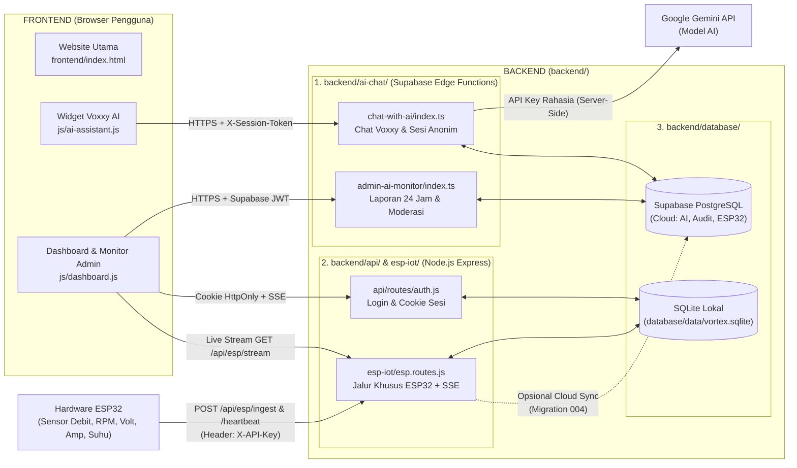
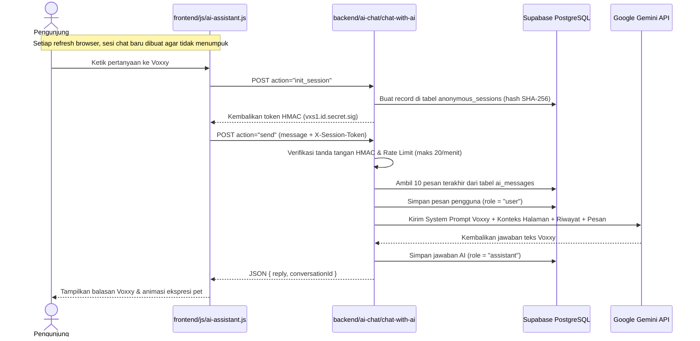
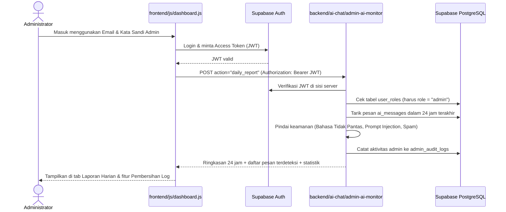
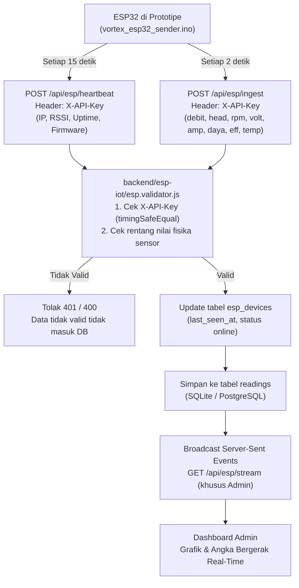
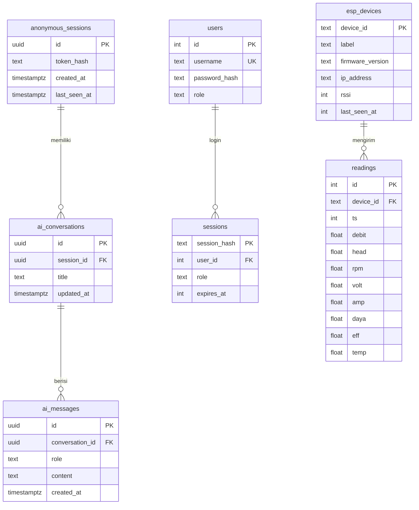

# Arsitektur & Diagram Alur Backend Vortex Hydro

Dokumen ini disusun khusus agar mudah dibaca dan dipelajari: bagaimana **Frontend**, **Backend**, **AI Chat (Voxxy)**, **Database**, dan **Perangkat ESP32** saling berkomunikasi dari ujung ke ujung.

---

## 1. Gambaran Besar Sistem (Frontend vs Backend)

Seluruh proyek dibagi menjadi **2 kategori besar**:
- **`frontend/`** — Yang berjalan di browser pengguna (HTML, CSS, JS, animasi 3D/cairan, gambar, & UI Dashboard).
- **`backend/`** — Yang berjalan di server/cloud untuk keamanan, kecerdasan AI, penyimpanan database, dan penerimaan data sensor ESP32.

---

## 2. Alur AI Chat (Voxxy) — Dari Pesan Masuk hingga Jawaban AI

> **Prinsip Keamanan:** `GEMINI_API_KEY` **tidak pernah** ditaruh di folder `frontend/`. Frontend hanya mengirim pesan ke `backend/ai-chat/chat-with-ai/index.ts`, lalu backend-lah yang berbicara ke Google Gemini dan menyimpan percakapan ke PostgreSQL.

---

## 3. Alur Dashboard Admin, Moderasi & Laporan Harian 24 Jam

---

## 4. Alur Jalur Khusus ESP32 (Hardware IoT → Backend → Dashboard)

Jalur ini disiapkan di `backend/esp-iot/` agar papan **ESP32** di prototipe Vortex Hydro bisa langsung mengirim pembacaan sensor (debit air, head, RPM, tegangan, arus, daya, efisiensi, dan suhu) ke server secara real-time.

---

## 5. Peta Tabel Database (`backend/database/`)

---

## 6. Panduan Belajar Cepat (Mulai dari Mana?)

1. **Belajar Frontend UI:** Buka `frontend/index.html`, `frontend/styles/main.css`, dan `frontend/js/app.js`.
2. **Belajar Integrasi AI (Voxxy):** Bandingkan `frontend/js/ai-assistant.js` (pengirim) dengan `backend/ai-chat/chat-with-ai/index.ts` (penerima & pemanggil Gemini).
3. **Belajar Database:** Baca `backend/database/sqlite.js` untuk SQLite lokal dan `backend/database/migrations/` untuk PostgreSQL di Supabase.
4. **Belajar Jalur ESP32 IoT:** Baca `backend/esp-iot/README.md`, `backend/esp-iot/esp.routes.js`, dan `backend/esp-iot/firmware-example/vortex_esp32_sender.ino`.
5. **Belajar Menguji Backend Otomatis:** Jalankan `cd backend && npm test` untuk melihat bagaimana seluruh API (Auth, Kunjungan, dan ESP32) diuji otomatis.
